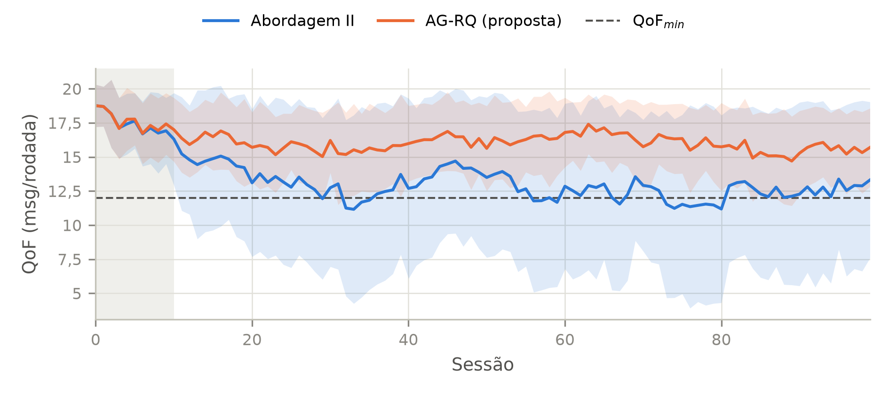
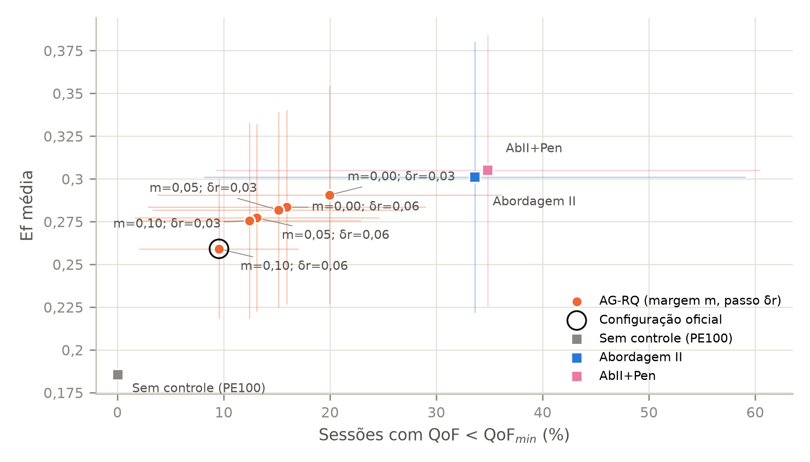

# AG-RQ: Algoritmo Genético com Restrição de Qualidade para RSSF densas

Simulador e experimentos de um **algoritmo genético com restrição de qualidade
(AG-RQ)** para o controle autonômico da **Probabilidade de Envio (PE)** em redes de
sensores sem fio (RSSF) densas.

Trabalho final da disciplina de Pesquisa Operacional (2026/2), Instituto de
Computação, Universidade Federal Fluminense (UFF). Reimplementa e estende a
abordagem de Bitencort Jr. (2008) — ver [Referência](#referência).

---

## Sumário

- [O problema](#o-problema)
- [A abordagem original](#a-abordagem-original)
- [A proposta: AG-RQ](#a-proposta-ag-rq)
- [O simulador](#o-simulador)
- [Experimentos](#experimentos)
- [Principais resultados](#principais-resultados)
- [Como rodar](#como-rodar)
- [Estrutura do repositório](#estrutura-do-repositório)
- [Saídas geradas](#saídas-geradas)
- [Reprodutibilidade e decisões de implementação](#reprodutibilidade-e-decisões-de-implementação)
- [Referência](#referência)
- [Licença](#licença)

---

## O problema

Uma rede tem um **nó coordenador** e `N` **nós sensores**, todos ao alcance do
coordenador e compartilhando o mesmo canal de rádio (IEEE 802.15.4). Em cada rodada,
cada sensor transmite sua leitura com probabilidade `PE`. Com muitos sensores
transmitindo ao mesmo tempo, as mensagens colidem e se perdem.

Duas medidas descrevem o desempenho em cada sessão `t`:

- **Eficiência** `Ef_t = recebidas / enviadas`: fração das transmissões
  aproveitadas (indica o desperdício de energia);
- **Qualidade da fusão** `QoF_t = recebidas / rodadas`: leituras recebidas por
  rodada (quanto mais, mais confiável a combinação dos dados).

As duas puxam em sentidos opostos: reduzir a PE aumenta a eficiência, mas reduz a
QoF. Neste trabalho a qualidade é tratada como **restrição**:

```
max   Ef(PE_t)
s.a.  QoF(PE_t) >= QoF_min
      PE_min <= PE_t <= 1
```

O coordenador não conhece uma fórmula do canal, as medidas são ruidosas e a rede
muda com o tempo (interferência, entrada de sensores). Por isso a PE é ajustada a
cada sessão por uma metaheurística que aprende durante o funcionamento.

## A abordagem original

Bitencort Jr. (2008) propôs ajustar a PE com um **sistema classificador + algoritmo
genético** executado no coordenador:

- cada regra é um cromossomo de **8 bits**: 4 de condição (a eficiência subiu ou
  caiu, e quanto) e 4 de ação (aumentar ou reduzir a PE, e quanto);
- **64 regras** em 16 ilhas (uma por condição) × 4 ações;
- a regra sorteada paga 10% do budget inicial a um **banco**; se for bem-sucedida na
  sessão seguinte, recebe todo o banco;
- a cada 2 sessões, o AG cruza as ações das 2 regras de maior budget de uma ilha
  (mutação de 1%) e o filho substitui uma regra da ilha.

Duas variantes:

- **AbI** (só eficiência): sucesso se `Ef_t > Ef_{t-1}`;
- **AbII** (eficiência com qualidade mínima): acima de `QoF_min`, sucesso se a Ef
  subiu; abaixo, sucesso se a QoF subiu.

**A falha:** a premiação ignora o quanto a qualidade caiu, e nada impede que uma
ação que reduz a PE seja aplicada quando a QoF já está no limite. O resultado são
quedas bruscas de qualidade, às vezes até perto de zero.

## A proposta: AG-RQ

O AG-RQ mantém as regras, ilhas, banco, cruzamento e mutação da AbII e muda apenas
dois pontos, usando as duas técnicas clássicas de tratamento de restrições em
metaheurísticas:

**1. Penalidade (critério de premiação).** A regra é premiada se a nota penalizada
melhorar (`F_t > F_{t-1}`), com

```
F_t = Ef_t − λ · max(0, QoF_min − QoF_t) / QoF_min,     λ = 2
```

Acima do mínimo, `F_t = Ef_t` (igual ao original); abaixo, recuperar a qualidade
vale mais do que ganhar eficiência.

**2. Reparo (trava de segurança na decisão).** Antes de aplicar a ação `ΔPE` da
regra, o coordenador verifica a qualidade da sessão:

| Faixa da qualidade | Ação aplicada |
|---|---|
| `QoF_t < QoF_min` | `max(ΔPE, +δr)` — a PE é obrigada a subir |
| `QoF_min ≤ QoF_t < (1+m)·QoF_min` | `max(ΔPE, 0)` — a PE não pode descer |
| demais casos | `ΔPE` — ação da regra sem alteração |

com margem `m = 0,10` e passo `δr = 0,06`. O reparo muda só a ação **aplicada**, nunca
a regra guardada, preservando a diversidade das ações.

Os dois mecanismos têm chaves independentes, o que permite um **estudo de ablação**
com seis métodos:

| Método | Descrição |
|---|---|
| `PE100` | sem controle (PE = 1 sempre) |
| `AbI` | abordagem original, só eficiência |
| `AbII` | abordagem original, eficiência com qualidade mínima |
| `AbII+Pen` | AbII + só a penalidade |
| `AbII+Rep` | AbII + só o reparo |
| `AG-RQ` | AbII + penalidade + reparo (proposta completa) |

## O simulador

Em vez de simular cada pacote, o simulador usa um modelo probabilístico do canal.
Em cada rodada:

1. `k ~ Binomial(N, PE)` sensores transmitem;
2. cada transmissão chega no prazo com probabilidade `s(k) = R / (K + k)`, ou seja,
   o número esperado de recebidas por rodada é `R·k / (K + k)`, que satura em `R`.

Os parâmetros `R = 23,52` e `K = 23,81` foram ajustados por mínimos quadrados aos
resultados da rede sem controle publicados na dissertação (Tabela A.2):

| N | QoF publicada | QoF simulada | Ef publicada | Ef simulada |
|---|---|---|---|---|
| 25 | 12 | 12,05 | 49,0% | 48,2% |
| 50 | 16 | 15,94 | 32,2% | 31,9% |
| 100 | 19 | 19,00 | 19,0% | 19,0% |
| 200 | 21 | 21,02 | 10,5% | 10,5% |

Outras características:

- 2000 rodadas por execução = 100 sessões de 20 rodadas (19 de coleta + 1 de
  ponto de avaliação); PE inicial = 1, `PE_min = 0,01`;
- **interferência**: cada sessão tem 10% de chance de perder 25% da capacidade;
- **números aleatórios comuns**: todos os métodos enfrentam, em cada semente, a
  mesma sequência de sessões com interferência;
- **oráculo analítico**: como Ef cai e QoF sobe com a PE, o ótimo é a menor PE
  viável, `PE* = min(1, K·QoF_min / (N·(R − QoF_min)))`. Para `N = 100` e
  `QoF_min = 12`: `PE* ≈ 0,248` e `Ef* ≈ 0,484`. O gap ao oráculo é
  `(Ef* − Ef) / Ef*`;
- simplificações: sem identificação individual dos sensores, sem CSMA/CA explícito,
  prazo embutido em `s(k)` e coordenador conhecendo o total enviado.

## Experimentos

Todos com 30 sementes (0–29); as 10 primeiras sessões de cada execução são
descartadas como aquecimento. Padrão: `N = 100`, `QoF_min = 12`.

| Exp. | Objetivo | Configuração |
|---|---|---|
| E1 | Validação do simulador | PE100 com N ∈ {25, 50, 100, 200}; AbI com N = 100 |
| E2 | Ablação (principal) | os 6 métodos; Wilcoxon pareado AbII × cada variante |
| E3 | Efeito do limiar | AbII × AG-RQ, N ∈ {50, 100}, QoF_min ∈ {9, 11, 12, 13, 15} |
| E4 | Efeito da densidade | AbII × AG-RQ, N ∈ {25, 50, 100, 200} |
| E5 | Cenário dinâmico | N passa de 100 para 200 na sessão 50 |
| E6 | Sensibilidade do reparo | AG-RQ, m ∈ {0; 0,05; 0,10} × δr ∈ {0,03; 0,06} |

O E6 é uma análise de sensibilidade definida antes de ver os resultados; os
parâmetros oficiais (`λ = 2`, `m = 0,10`, `δr = 0,06`) não foram alterados.

## Principais resultados

Ablação (E2), média (desvio) entre 30 sementes, sessões 10–99:

| Método | Ef média | QoF média | QoF mínima | Violação (%) | Gap ao oráculo |
|---|---|---|---|---|---|
| PE100 | 0,186 (0,001) | 18,55 (0,14) | 13,17 (0,36) | 0,0 (0,2) | 0,617 (0,003) |
| AbI | 0,322 (0,099) | 11,90 (4,28) | 2,86 (4,67) | 40,7 (29,2) | 0,335 (0,204) |
| AbII | 0,301 (0,079) | 12,92 (3,72) | 3,11 (4,74) | 33,6 (25,5) | 0,378 (0,164) |
| AbII+Pen | 0,305 (0,079) | 12,82 (3,67) | 2,87 (4,66) | 34,9 (25,6) | 0,370 (0,164) |
| AbII+Rep | 0,261 (0,043) | 15,96 (1,35) | 8,82 (2,40) | 9,9 (7,3) | 0,460 (0,088) |
| **AG-RQ** | 0,259 (0,041) | 16,01 (1,34) | 8,94 (2,31) | **9,6 (7,5)** | 0,464 (0,085) |

Teste de Wilcoxon pareado (bicaudal), AbII × cada variante:

| Comparação | Ef | QoF média | QoF mínima | Violação |
|---|---|---|---|---|
| AbII × AbII+Pen | 0,177 | 0,638 | 0,953 | 0,195 |
| AbII × AbII+Rep | 2,7·10⁻⁴ | 1,1·10⁻⁵ | 1,1·10⁻⁵ | 1,8·10⁻⁵ |
| AbII × AG-RQ | 1,7·10⁻⁴ | 1,0·10⁻⁵ | 1,1·10⁻⁵ | 1,2·10⁻⁵ |

- **O reparo é o mecanismo efetivo.** A violação cai de 33,6% para 9,6% e a pior
  sessão sobe de 3,1 para 8,9 leituras por rodada (p < 0,001).
- **A penalidade sozinha não teve efeito significativo** (p ≥ 0,17 em todas as
  métricas). Com a escolha uniforme das regras, o budget só influencia quem vira
  pai na evolução, e o sinal de aprendizado é fraco. Esse resultado negativo é
  relatado como está.
- **O ganho em qualidade tem custo de eficiência.** A Ef cai de 0,301 para 0,259 e
  o total de mensagens enviadas sobe cerca de 33%; a QoF média (16) fica bem acima
  do mínimo (12).
- **O compromisso é ajustável (E6).** Margens e passos menores dão mais eficiência
  e mais violação; mesmo a configuração mais branda (m = 0, δr = 0,03: violação de
  20,0% e Ef de 0,291) viola menos que a AbII com quase a mesma eficiência.

QoF por sessão, AbII × AG-RQ (média de 30 sementes ± 1 desvio):



Compromisso entre violação e eficiência (E6), com PE100, AbII e AbII+Pen como
referência:



Os resultados de E1, E3, E4 e E5 estão nas tabelas de `results/` e nas demais
figuras de `figuras/`.

## Como rodar

Requisitos: Python 3.10 ou superior (testado no 3.15) e as bibliotecas `numpy`,
`pandas`, `matplotlib`, `scipy` e `pytest`.

**Windows (PowerShell)**

```powershell
python -m venv .venv
.venv\Scripts\Activate.ps1
pip install -r requirements.txt
```

**Linux / macOS**

```bash
python3 -m venv .venv
source .venv/bin/activate
pip install -r requirements.txt
```

**Testes**

```bash
python -m pytest -q
```

**Experimentos**

```bash
python -m src.experiments --exp all          # E1–E6, 30 sementes (~20 s)
python -m src.experiments --exp E2           # só um experimento
python -m src.experiments --exp all --seeds 5    # rodada rápida
```

Opções: `--exp {E1,E2,E3,E4,E5,E6,all}`, `--seeds` (número de sementes, padrão 30),
`--out` (pasta das tabelas, padrão `results/`) e `--fig` (pasta das figuras, padrão
`figuras/`). Os arquivos existentes são sobrescritos.

**Uso direto do simulador**

```python
from src.controllers import Proposed
from src.simulator import run
from src.metrics import compute_metrics

df = run(Proposed(use_penalty=True, use_repair=True), seed=0, n_nodes=100)
print(compute_metrics(df, qof_min=12.0))
```

## Estrutura do repositório

```
src/
  config.py        parâmetros (canal, simulação, AG, penalidade e reparo)
  channel.py       modelo do canal s(k) = R/(K+k) e interferência
  classifier.py    cromossomo de 8 bits, população, banco e evolução
  controllers.py   PE100, AbI, AbII e Proposed (penalidade/reparo)
  oracle.py        PE ótima analítica e gap
  simulator.py     laço de sessões e rodadas
  metrics.py       métricas por execução
  experiments.py   experimentos E1–E6 (linha de comando)
  plots.py         figuras
tests/             testes (pytest) de cada módulo
results/           tabelas (CSV e LaTeX) e registros de decisões
figuras/           figuras (PNG, 300 dpi)
```

## Saídas geradas

Em `results/`, para cada experimento `eX`:

- `eX_runs.csv`: métricas de cada execução (método, cenário, semente);
- `eX_series.csv`: séries por sessão (PE, QoF, Ef, enviadas, recebidas, reparos);
  não gerado no E6;
- `eX_resumo_numerico.csv`: média e desvio de cada métrica por configuração;
- tabelas prontas em CSV e LaTeX (booktabs): `e1_validacao`, `e1_abi_trechos`,
  `e2_ablacao`, `e2_wilcoxon`, `e2_trechos`, `e3_limiar`, `e4_densidade`,
  `e5_dinamico` e `e6_sensibilidade`.

Métricas por execução: `ef_mean`, `qof_mean`, `qof_min`, `viol_rate`, `pe_mean`,
`pe_std`, `pe_reversals`, `sent_total`, `repairs` e `gap_oracle`.

Em `figuras/`: `qof_tempo.png`, `pe_tempo.png`, `ablacao_violacoes.png`,
`ablacao_ef_qof.png`, `limiar.png`, `densidade.png`, `dinamico.png`,
`validacao_abi.png` e `sensibilidade_tradeoff.png`.

## Reprodutibilidade e decisões de implementação

- Cada semente `s` usa dois geradores: `rng_channel = default_rng(s)` (canal) e
  `rng_ctrl = default_rng(s + 10000)` (controlador). A mesma semente reproduz
  exatamente a mesma execução.
- Pontos que a dissertação original não especifica (ordem dos bits, cobrança com
  piso de budget, primeiro ponto de avaliação, ponto de corte do cruzamento,
  momento da evolução, cálculo das métricas etc.) estão documentados em
  [`results/decisoes_implementacao.md`](results/decisoes_implementacao.md).
- Alterações de parâmetros e análises de sensibilidade ficam registradas em
  [`results/ajustes.md`](results/ajustes.md). Nenhum parâmetro oficial foi ajustado
  a partir dos resultados.

## Referência

Bitencort Junior, B. R. (2008). *Fusão de Dados Paralela em Redes de Sensores Sem
Fio Densas Utilizando Algoritmo Genético*. Dissertação de Mestrado, Universidade
Federal de Santa Catarina. <https://repositorio.ufsc.br/handle/123456789/90842>

## Licença

Distribuído sob a licença MIT. Veja [LICENSE](LICENSE).
